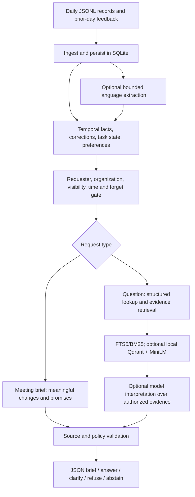

# TraceMind — The Work Assistant That Remembers

**BuildSprint Round 3 · Evidence-grounded workplace memory · Privacy-first by design**

> A client meeting starts tomorrow. Tasks have changed owners, deadlines have moved, and someone corrected yesterday's brief. TraceMind helps you find **what changed, what was promised, and what is safe to say**—with a source for every supported claim.

TraceMind is a stateful, local-first workplace memory assistant built around a **JSON-only Python command-line interface (CLI)**. It processes daily workplace activity, creates concise meeting briefs, answers historical questions, remembers feedback, and respects visibility and forgetting rules. An optional local Studio offers a visual demonstration; the **CLI is the evaluated deliverable**.

### Highlights

- **Meeting briefs:** Changes since the previous client meeting, outstanding commitments, suggested records, and one useful question—or `nothing_new`.
- **Cited answers:** Real record IDs support facts; uncertainty leads to clarification, refusal, or an honest abstention.
- **Durable, temporal memory:** SQLite retains facts, task updates, feedback, and corrections across independent processes.
- **Permission-first retrieval:** Organization, record visibility, requester, time cutoff, and forgetting are enforced before evidence reaches an answer or an optional model.
- **Selective model assistance:** OpenAI can interpret unfamiliar language, corrections, and Hinglish commitments. Local rules remain the fallback.
- **Optional semantic search:** SQLite FTS5/BM25 plus local MiniLM and Qdrant, with source authorization rechecked after retrieval.

## Public evaluation snapshot

| Area | Offline public score |
| --- | ---: |
| Meeting briefs | 20/20 |
| Answers | 15/15 |
| Honesty / grounding | 15/15 |
| Persistent memory | 15/15 |
| Privacy | 10/10 |
| Cost | 10/10 |
| **Total, days 1–5** | **85/85** |

**Scope:** This result was measured with the deterministic, model-off CLI on the public organizer fixture. It is **not** a hidden-day, live-OpenAI, or guaranteed 100/100 score. A later local test run reported **200 tests, 0 failures, 48 fixture-dependent skips** before setting the external dataset path. See [EVALUATION.md](EVALUATION.md) for methodology and remaining limitations.

## Quick start — the graded CLI

**Requirements:** Python 3.11+ and the organizer's data pack. The deterministic CLI does **not** need an API key, Docker, Node.js, or Qdrant.

The clean source repository intentionally **does not include** the organizer's `data/` and `answers/` directories. Set `R3_PACK` to the extracted organizer pack containing `data/people.json` and `data/days/day-01.jsonl`.

**Windows PowerShell:**

```powershell
$env:R3_PACK = 'C:\path\to\organizer-pack'
$env:TRACEMIND_USE_LLM = '0'
$env:TRACEMIND_VECTOR_DB = '0'
Test-Path "$env:R3_PACK\data\days\day-01.jsonl"  # True

python tracemind.py ingest --day 1
python tracemind.py brief --person p02 --date 2026-11-03
python tracemind.py ask --person p02 --at '2026-11-02T18:00:00Z' --ask 'Who owns billing for NB?'
python tracemind.py forget --person p02 --what 'Forget my Dubai trip'
```

**Linux / macOS:**

```bash
export R3_PACK='/path/to/organizer-pack'
export TRACEMIND_USE_LLM=0 TRACEMIND_VECTOR_DB=0
python3 tracemind.py ingest --day 1
python3 tracemind.py brief --person p02 --date 2026-11-03
python3 tracemind.py ask --person p02 --at '2026-11-02T18:00:00Z' --ask 'Who owns billing for NB?'
python3 tracemind.py forget --person p02 --what 'Forget my Dubai trip'
```

All four commands print **machine-readable JSON to stdout**. Logs belong on stderr. Each invocation is a separate process: state persists in SQLite. The expected JSON schemas and input fields are documented in [DATA_FORMAT.md](DATA_FORMAT.md).

### Reproduce the public results

With the organizer pack mounted as `R3_PACK`, run:

```powershell
$env:TRACEMIND_USE_LLM = '0'
$env:TRACEMIND_VECTOR_DB = '0'
python -m unittest discover -s tests -q
python tools/run_days.py --cmd 'python tracemind.py' --days 1-5 --out runs/public-check
python tools/score.py --run runs/public-check --days 1-5
python tools/agent_privacy_audit.py
```

Without `R3_PACK`, the source-only repository cannot run the public scorer; fixture-dependent tests may be skipped. The organizer provides days 6–15 only during hidden evaluation. The scorer is for **verification**, not the source of answers.

## How it works



**The trust boundary is Python, not the LLM.** SQLite is the source of truth. Model suggestions and vector similarity never override record permissions or become source citations by themselves.

### Memory, corrections, and forgetting

Records are time-ordered and source-linked. A later correction from a sufficiently authoritative person can supersede an earlier claim without rewriting history. Feedback changes one user's future briefs; it must not leak into someone else's results or into earlier as-of queries.

Forgetting prevents matching information from appearing again for the requester, including after reingestion. **This is not a claim of universal physical erasure:** shared records or embeddings can remain for other authorized users. See [DESIGN_NOTE.md](DESIGN_NOTE.md) and [SECURITY_AUDIT.md](SECURITY_AUDIT.md).

## Optional OpenAI interpretation

Install the adapter dependencies:

```powershell
python -m pip install -r model-requirements.txt
Copy-Item .env.example .env
```

Set these values **only in your local environment or uncommitted `.env`**:

```dotenv
TRACEMIND_USE_LLM=auto
TRACEMIND_MODEL=gpt-4.1-mini
OPENAI_API_KEY=YOUR_OWN_KEY
TRACEMIND_MAX_INGEST_CALLS=12
```

| Mode | Behavior |
| --- | --- |
| `auto` (default) | Uses the configured API key for supported, bounded model calls |
| `0` | Forces offline execution—even if a key exists |
| `1` | Enables supported model calls when a key exists |

Model selection, pricing, input budgets, and fallback logic are described in [MODEL_EVALUATION.md](MODEL_EVALUATION.md). The design applies **4,000 input-token preflight budget per question** and **8,000 per brief**. SDK usage values are collected when calls succeed; configured per-million-token model prices estimate USD cost. Where token counts are estimates, they should not be presented as exact billing. If you use an unsupported/unpriced model, configure its price rates rather than silently treating calls as free.

**Live-model status:** The JSON request format was tested, but a complete successful paid-model public replay is **not verified**. A reported live attempt hit insufficient API credits. Do not interpret the 85/85 offline score as a model-on score.

```powershell
python tools/smoke_hybrid_model.py
# After a successful synthetic smoke test and with an authorized key:
python tools/run_days.py --cmd 'python tracemind.py' --days 1-5 --out runs/model-check
python tools/score.py --run runs/model-check --days 1-5
python tools/audit_model_usage.py --run runs/model-check
```

**Privacy note:** Activating remote interpretation can send eligible **team-visible** workplace evidence to the model provider. Use only a key and data for which this processing is authorized. Private and restricted record bodies are excluded from the model-evidence path.

## Optional vector retrieval and local Studio

These are **demonstration and retrieval extensions**, not requirements for the graded CLI.

```powershell
python -m pip install -r vector-requirements.txt
python tools/vector_db_smoke.py
python tools/vector_db_smoke.py --real-model

python -m pip install -r studio-requirements.txt
python launch_studio.py
```

Open `http://127.0.0.1:8765` for the Studio. The repo includes the prebuilt frontend, so Node.js is not required just to view the demo. Node/npm are needed for frontend **development**.

The Studio is **localhost-only**. Selecting a demo persona is **not authentication**; do not expose it to the public internet. Its action agent stages tasks, call plans, and drafts for confirmation rather than sending emails or making calls. Qdrant locally indexes team-visible embeddings and enforces current source authorization on retrieval. See [VECTOR_DB_README.md](VECTOR_DB_README.md).

## Repository guide

| File | Purpose |
| --- | --- |
| [`tracemind.py`](tracemind.py) | Graded four-command CLI and core memory engine |
| [`tracemind_hybrid.py`](tracemind_hybrid.py) | Optional model extraction and grounded reasoning |
| [`tracemind_temporal.py`](tracemind_temporal.py) | Time-aware fact and deadline management |
| [`tracemind_model_config.py`](tracemind_model_config.py) | Model activation, input budgets, pricing |
| [`tracemind_semantic.py`](tracemind_semantic.py) | Local semantic retrieval |
| [`tracemind_vector_db.py`](tracemind_vector_db.py) | Qdrant vector integration |
| [`studio_api.py`](studio_api.py) | Local FastAPI Studio server |
| [`tests/`](tests/) | Regression, adversarial and privacy cases |
| [`tools/`](tools/) | Evaluation, replay, audits and smoke tests |
| [`DESIGN_NOTE.md`](DESIGN_NOTE.md) | Short design note for the organizers |
| [`JUDGE_HANDOFF.md`](JUDGE_HANDOFF.md) | Reproducible evaluator handoff |

**Engineering principles:** evidence before fluency; permissions before retrieval; authority before recency; source IDs before claims; safe refusal before guessing.

## Limits and disclosure

- Hidden days 6–15 and the organizer's design/live-session marks are not locally measurable.
- Public privacy invariants are not proof against every possible semantic or multi-user attack.
- Remote model execution is optional, may incur charges, and needs separate authorization.
- TraceMind was developed and reviewed with assistance from ChatGPT and Kiro. The candidate is responsible for understanding, testing and presenting the implementation.

**Submission:** Share this Git repository and the one-line runner `python tracemind.py` with the short [design note](DESIGN_NOTE.md). Add a video, evaluation report, or other files only when required by the finale's separate submission instructions.
